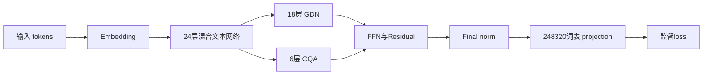

# 架构与优化判断

Qwen3.5-2B 的24个文本层包括18层 Gated DeltaNet 线性注意力和6层全注意力 GQA；hidden2048、FFN intermediate6144、词表248320。它不是MoE或MLA模型，不能直接用MoE token dispatch或稀疏MLA推理成果解释当前SFT提速。

图示是模块关系，不表示GDN和GQA在每层并行；具体层顺序以公开模型配置为准。

LoRA降低可训练参数和优化器状态，但反向仍需经过冻结权重计算输入梯度。checkpoint减少保存激活，代价是反向阶段重跑部分前向。关闭短样本checkpoint后，forward次数下降；长样本恢复checkpoint，避免用常规batch的显存估计覆盖尾部。

完整词表logits在短答案SFT中也可能很大：例如batch4、length1365、vocab248320，单FP32张量约 `4×1365×248320×4/2³⁰≈5.05 GiB`；dtype转换或loss临时副本另占空间。这是尺寸估计，不等于某个时刻的实际峰值。只投影监督位置在代数上可成立，BF16舍入和Adam更新仍需整模验收，不能仅看loss。

## 五类公开组件与当前任务的关系

| 组件方向 | 可研究的设计 | 当前采用边界 |
|---|---|---|
| TileKernels RMSNorm | FP32归约、UB复用、数值补偿 | 受限算法回移通过；不计端到端训练加速 |
| DeepGEMM-Ascend | tile、L1驻留、多缓冲、BF16后端 | 当前SDK公共新头文件探针失败；没有报告GEMM收益 |
| DeepSelect TopK | radix/histogram | teacher-forcing SFT没有该TopK热点；未跑完整内核 |
| DeepEP | MoE dispatch/combine | 当前模型非MoE，DDP走HCCL；未采用 |
| FlashMLA | sparse MLA和KV调度 | 与GDN/GQA不同；不能外推dense backward支持 |

新硬件低精度/MX指令吞吐不能通过“反量化后BF16计算”直接继承。旧AscendC能表达某算法，也不意味着其调度、缓冲和精度与新后端相同。

## 下一步优先级

先固定环境和有效工作量，建立无profiler稳态基线；再一次改变一个变量。若继续融合GDN，应先通过真实输入分布的算子检查、全部LoRA梯度与Adam门禁，再做完整训练质量和长尾验证。已经拒绝的有限级数不能仅凭microbenchmark较快重新采用。

算子密集、低利用率和通信长区间是线索；要分别核实host发射、kernel形状、内存流量、跨rank到达与profile扰动。NPU利用率采样不直接等于算力效率，allocated不直接等于整卡显存，通信duration不直接等于网络传输。
